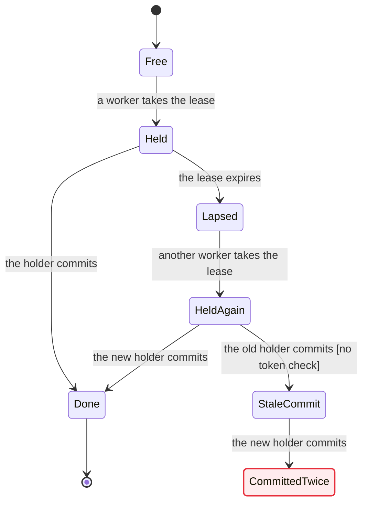

# Worked example: a job lease

Run with TLC from `tla2tools.jar` v1.7.4 on Java 21. The outputs below are from those runs. The same design was also checked on real TypeScript code with generated inputs, which found the same counterexample. See [../property-based.md](../property-based.md).

## The target

- Promise: a job commits its result at most once.
- Harm: the customer is charged twice.
- Why tests miss it: the break needs a lease to expire while its holder is still working, then a second worker to take the job.

## The model

[JobLease.tla](JobLease.tla) has three actions. Each maps to one indivisible step in the code.

| Action | Step in the code |
|---|---|
| `Acquire(w)` | One conditional write to the lease table that also raises the token. |
| `Expire` | The lease's time to live runs out. The holder is not told. |
| `Commit(w)` | One write of the result. With fencing, the store compares the token in the same write. |

The invariant `AtMostOneCommit` is the promise.

## Run it

```bash
java -cp tla2tools.jar tlc2.TLC -config JobLease.cfg -workers 1 JobLease.tla
```

[JobLease.cfg](JobLease.cfg) sets `Fenced = TRUE`. TLC exits with status 0 and prints:

```
Model checking completed. No error has been found.
63 states generated, 49 distinct states found, 0 states left on queue.
The depth of the complete state graph search is 8.
```

## Show it can fail

```bash
java -cp tla2tools.jar tlc2.TLC -config JobLeaseBroken.cfg -workers 1 JobLease.tla
```

[JobLeaseBroken.cfg](JobLeaseBroken.cfg) sets `Fenced = FALSE`, which removes the token check from `Commit`. TLC exits with status 12 and prints the trace, trimmed here to the action and the changed values:

```
Error: Invariant AtMostOneCommit is violated.
Error: The behavior up to this point is:
State 1: <Initial predicate>      token = 0, lease = NoOne, committed = {}
State 2: <Acquire ...>            token = 1, lease = w1, held[w1] = 1
State 3: <Expire ...>             lease = NoOne
State 4: <Acquire ...>            token = 2, lease = w2, held[w2] = 2
State 5: <Commit ...>             committed = {w1}
State 6: <Commit ...>             committed = {w1, w2}
```

In a real repo, break the code rather than flip a constant: remove the token check from the commit path in a scratch change, mirror that in the model, and confirm the check fails.

## The counterexample, in the code's words

1. Worker 1 takes the lease and gets token 1.
2. The lease expires. Worker 1 is still working.
3. Worker 2 takes the lease and gets token 2.
4. Worker 1 commits its result. Nothing checks its stale token.
5. Worker 2 commits its result. The job is now committed twice.

## The chart



Legend: the red state breaks "a job commits its result at most once". With the token check in place, the arrow into `StaleCommit` does not exist.

## Bounds and what is left out

- Two workers, at most three lease grants.
- One job. Many jobs sharing a worker are not modelled.
- The token check and the write are one step. If the code reads the token and then writes in two steps, this model does not describe it.
- Clocks are not modelled. Expiry can happen at any moment.
