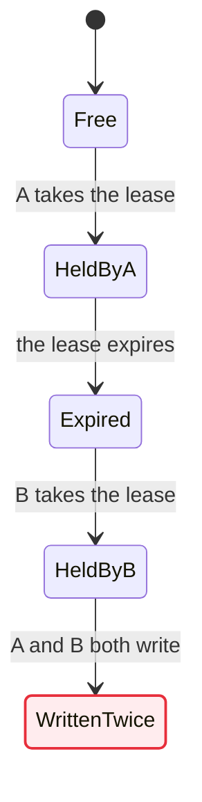

# Draw the behaviour as a statechart

The chart shows how the system moves between states, in the words of the person who reads it. That reader decides whether the behaviour is right. They should not need the spec.

## Rules become invariants

Ask the reader for the rules in their words: "You never see Synced while you are offline." Write each rule as an `INVARIANT`. If the model has no variable for a rule, add the variable. Never weaken a rule to make it hold.

## Build the chart from the state graph

1. Run the check with a state graph dump. See [tlc.md](tlc.md) for the `-dump dot,actionlabels` option. The dot file holds one node per reachable state and one edge per step, labelled with its action.
2. Write a small script that reads the dot file. Keep it next to the model. It maps each model state to a reader label and each action to a reader label, then prints Mermaid. A script can be rerun. A hand-drawn chart cannot.
3. Merge model states that share a label into one chart state. Draw one arrow per distinct pair of labels and step label. Drop steps that stay inside one label.
4. Print a `stateDiagram-v2`.

Rebuild the chart on every change to the model. Do not edit the Mermaid by hand.

## Labels

- Label a state with what the reader can see or cares about: "Paying", "Lease held, write pending". Keep variable names out.
- Label a step as the reader sees it happen: "you press play", "the lease expires". Do not name the code or the TLA+ action.
- When a step is only possible under a condition, end its label with the condition in brackets: `you press play [while the file loads]`.

## Mark what breaks

- A chart state where every model state behind it breaks a rule gets the class `breaks`.
- A chart state where only some do gets `mayBreak`. If that hides where a rule breaks, split the label.
- Do not merge two states that break different rules.
- Add a legend that names the rule behind each mark.

## Shortest path per rule

For each broken rule, give the shortest path from a start state to the breaking state, as numbered steps in reader labels. TLC's trace for an invariant is already a shortest one when it runs breadth-first with one worker. For other rules, search the dot graph.

## Keep it readable

Aim for about 20 arrows. To get there:

1. Use coarser labels. Give one label to values that act the same.
2. Leave out a detail the reader does not need, such as a call in flight whose return changes nothing.
3. Hide steps the reader does not need, such as a reset every state has.

When you hide steps: keep every chart state reachable from a start state, keep at least one arrow out of each state that has a step out in the model, and hide all steps of an arrow or none. Keep every state on a bug path and every mark.

## Hand off

Give the chart and its Mermaid text to the person who decides. Add one line per bug: the rule, the reader's sentence for it, and the numbered path. Say which steps the chart hides and what the model leaves out. Give the command that rebuilds the chart.
