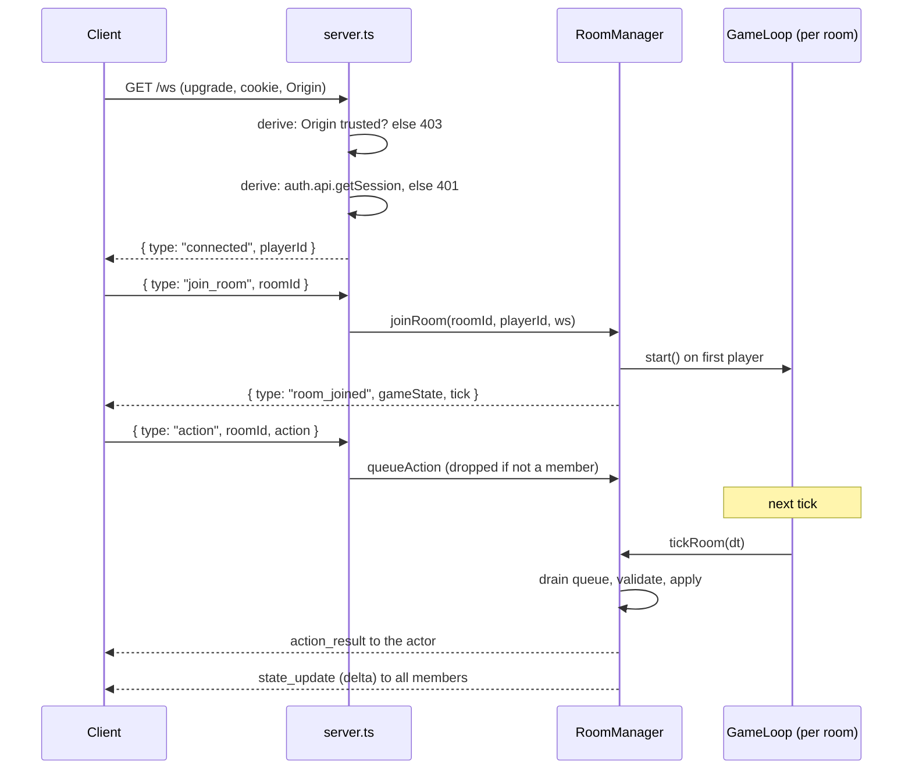
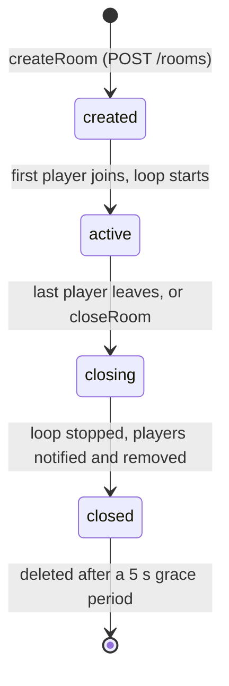

# Architecture diagrams

Two flows the boilerplate implements, drawn out. `SKILL.md` has the rules.

## Connection and action flow

## Room lifecycle

Persist the final state in the `closing` step (the hook is a comment in `beginCloseRoom`), not inside a tick.
