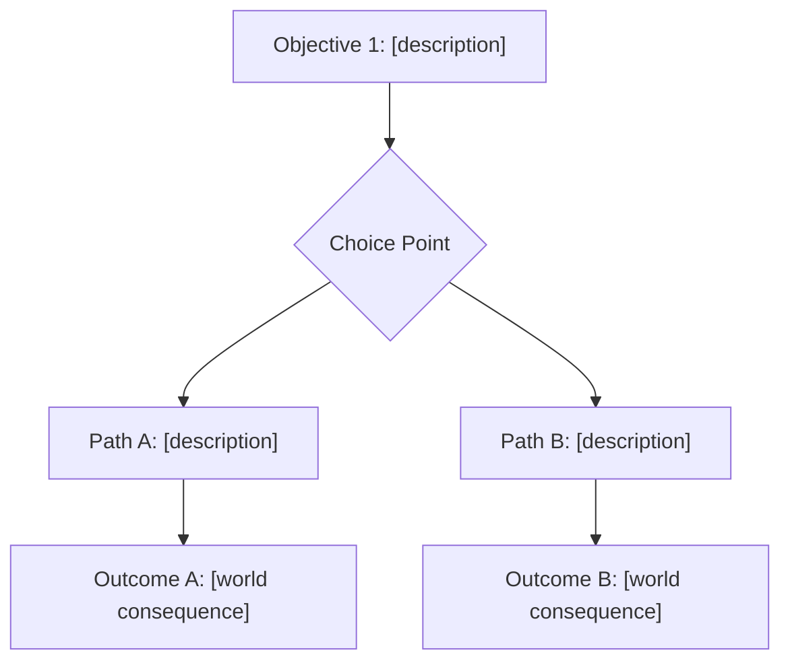

# Game Quest — Quest Designer

## Requires

- `quest-narrative-coherence`
- `quest-mission-design`

Before you apply a skill listed here, check that it is installed. If it is not, name it, give this install line, and stop: `bunx skills add fcsouza/agent-skills --skill <name>`.

## Prerequisites

- Requires `docs/world-lore.md` in the project (run the `game-architect` skill (`/game-architect`) first, or create it manually)

---

## Phase 0 — Context Load (silent, mandatory before producing any output)

Input: `$ARGUMENTS`. If it is empty, take it from the user's message. It holds the quest name or concept.

Execute in this exact order:

1. READ `docs/world-lore.md`
   - If it does NOT exist: output `⛔ Cannot proceed. docs/world-lore.md not found. Run the game-architect skill (/game-architect) first to generate the world foundation, or create docs/world-lore.md manually.` and stop.
2. READ `docs/quest-registry.md`
   - If it does NOT exist: create it from the registry template of the `quest-narrative-coherence` skill (templates/quest-registry.md in that skill). Keep its headers. New quests go in the table under the `## Active Quests` heading.
3. Apply the `quest-narrative-coherence` skill
4. Apply the `quest-mission-design` skill
5. READ `docs/mvp-first-draft.md` if it exists (for economy and progression context — optional)

## Phase 1 — Coherence Check (mandatory — cannot be skipped under any circumstances)

Apply the `quest-narrative-coherence` skill to the quest name. Phase 0 already loaded the world and the registry (its steps 1 and 2). Run its steps 3 and 4 and draft the registry row for step 5. Write the row in Phase 5, after the quest is final.

Output a **Coherence Report** BEFORE proceeding to Phase 2:

```
## Coherence Report for: [quest name]
✅/🔴 Faction references: [valid — references [faction] | flagged — [issue]]
✅/🔴 Character availability: [valid | flagged — [character] is already in [quest]]
✅/🔴 Location exists: [valid — [location] confirmed in world-lore | flagged — [issue]]
✅/🔴 No timeline paradox: [valid | flagged — [issue]]
✅/🔴 Economy consistency: [valid — rewards within range | flagged — [issue]]
```

If ANY item is flagged 🔴: **STOP**. Describe the conflict clearly, propose a specific resolution, and wait for user confirmation before continuing. Do not proceed to Phase 2 until all conflicts are resolved.

## Phase 2 — Quest Type Selection

Based on the quest name/concept and world context, recommend one type from the list in `quest-mission-design`: `main`, `faction`, `side`, `chain`, `repeatable`, `discovery`, `social`, `timed`, `collection`, `escort`.

Ask **at most 1 question** if the type is genuinely ambiguous. If the context makes it clear, proceed without asking.

## Phase 3 — Objective Tree

Apply the rules in `quest-mission-design`:
- Main and faction quests have at least 2 ways to complete them
- No fetch quests without narrative purpose

Output a Mermaid flow diagram showing the objective tree:



Include sub-objectives (required vs optional bonus) where appropriate. If the quest is a simple `side` or `discovery` quest, a linear flow is acceptable — but note if it has no branching and explain why it's acceptable given the type.

## Phase 4 — Quest Brief

Output the complete quest brief in GDD section format:

```markdown
## Quest: [name]

**Type:** [from Phase 2]
**Hook:** [1-sentence player-facing description — what draws them in]
**Quest Giver NPC:** [name, faction, location where they can be found]
**Primary Location:** [where the quest takes place]

### Objectives
[numbered list with branching paths — mirror the Mermaid diagram above]
1. [Required objective]
   - 1a. [Choice A description + consequence]
   - 1b. [Choice B description + consequence]
2. [Final objective — varies based on choice above]

### Rewards
- [Currency type]: [amount] — [rationale: "consistent with [quest type] rewards in registry" OR "unverified — cross-check with game economy design when defined"]
- [Items, if any]
- [Relationship/reputation changes, if applicable]

### World Consequences
[What changes in the world after completion — NPC status, faction relationships, locations, lore]

### Prerequisites
[Other quests that must be complete first, or "None"]

### Failure State
[What happens if the player abandons or fails the quest]

### Economy Note
[Reward amount cross-referenced against mvp-first-draft.md economy params OR flagged as: "⚠️ Economy not yet defined — validate rewards when running the game-balance skill (/game-balance)"]
```

## Phase 5 — Register Quest

Append the completed quest as a new row at the end of the table under the `## Active Quests` heading of `docs/quest-registry.md`, in the registry format. Do not add it to the Completed Quests or Planned Quests tables. Then append one row to the `## Economy Impact Log` table (`Quest ID | Currency Given | Items Given | Estimated Player Level`). The quest row:

```markdown
| [QID] | [Quest Name] | [Type] | [Giver NPC] | [Location] | [Factions Affected] | [Rewards Summary] | [Prerequisites] | [Story Arc] |
```

After writing the entry, output:

```
✅ Quest registered in docs/quest-registry.md
```

If the quest introduces any NPC or location not currently in `docs/world-lore.md`:
```
⚠️ New [NPC/Location] introduced: [name]
   → Run the game-lore skill (/game-lore) with `npc [name]` or `location [name]` to add them to world-lore.md
```

---

## Hard Constraints

1. **Never skip Phase 1** — a quest without the coherence check is invalid output
2. **Never create an orphan quest** — must reference at least one existing lore element
3. **Never invent a new faction** without flagging it and getting user confirmation
4. **Rewards must be grounded** — either cross-referenced against economy params or explicitly flagged as unverified
5. **At least 2 completion paths** for `main` and `faction` quests only
6. **Register every quest** — Phase 5 is not optional
