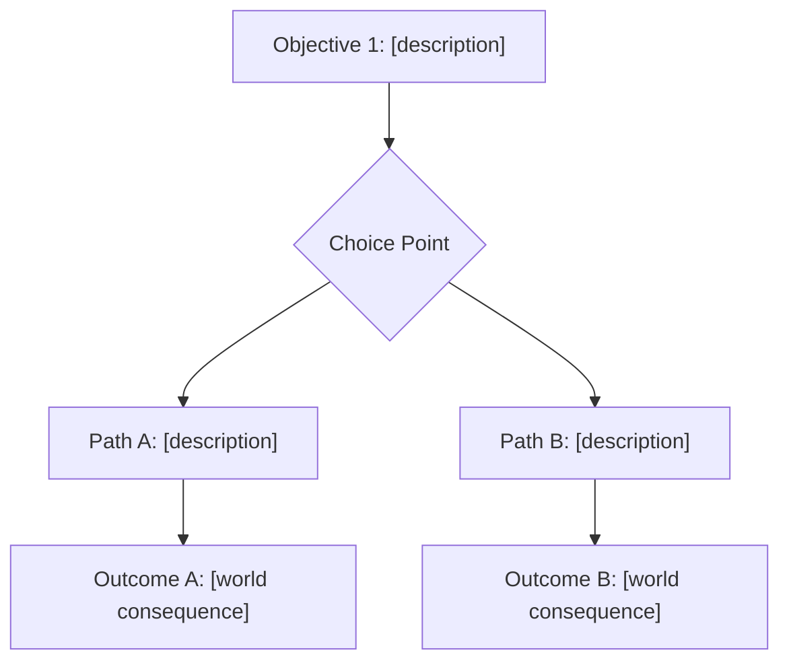

# Game Quest: Quest Designer

## Requires

- `quest-narrative-coherence`
- `quest-mission-design`

Before you apply a skill listed here, check that it is installed. If it is not, name it, give this install line, and stop: `bunx skills add fcsouza/agent-skills --skill <name>`.

## Prerequisites

- `docs/world-lore.md` in the project. Run `/game-architect` first, or create it by hand.

---

## Phase 0: Context load (silent, before any output)

Input: `$ARGUMENTS`. If it is empty, take it from the user's message. It holds the quest name or concept.

1. Read `docs/world-lore.md`. If it does not exist, output "Stopped: docs/world-lore.md not found. Run `/game-architect` to generate the world foundation, or create the file by hand." and stop.
2. Read `docs/quest-registry.md`. If it does not exist, create it from the registry template of the `quest-narrative-coherence` skill (templates/quest-registry.md in that skill). Keep its headers. New quests go in the table under `## Active Quests`.
3. Apply the `quest-narrative-coherence` skill.
4. Apply the `quest-mission-design` skill.
5. Read `docs/mvp-first-draft.md` if it exists. It gives economy and progression context.

## Phase 1: Coherence check (never skip)

A quest that skipped the check can contradict the lore or double-book an NPC, so reject it. Apply the `quest-narrative-coherence` skill to the quest name. Phase 0 already did its steps 1 and 2. Run its steps 3 and 4 and draft the registry row for step 5. Write the row in Phase 5, after the quest is final.

Output a Coherence Report before Phase 2. Use the coherence checklist template of the `quest-narrative-coherence` skill (templates/coherence-checklist.md in that skill). It lists every item of step 3 and the anchor check of step 4. Mark each item "Valid" or "Conflict: [issue]".

If any item is a conflict, stop. Describe the conflict, propose a specific fix, and wait for the user to confirm. Do not start Phase 2 until every conflict is resolved.

## Phase 2: Quest type

Recommend one type from the list in `quest-mission-design`, based on the quest name and the world context. Ask at most one question, and only if the type is truly ambiguous.

## Phase 3: Objective tree

Apply the rules in `quest-mission-design`. Output a Mermaid flow diagram of the objective tree:



Mark sub-objectives as required or optional bonus. A linear flow is fine for a simple `side` or `discovery` quest. Say that it has no branching and why that suits the type.

## Phase 4: Quest brief

Output the full brief in GDD section format:

```markdown
## Quest: [name]

**Type:** [from Phase 2]
**Hook:** [one player-facing sentence: what draws them in]
**Quest Giver NPC:** [name, faction, location where they can be found]
**Primary Location:** [where the quest takes place]

### Objectives
[numbered list with branching paths, mirroring the Mermaid diagram]
1. [Required objective]
   - 1a. [Choice A description + consequence]
   - 1b. [Choice B description + consequence]
2. [Final objective, varies with the choice above]

### Rewards
- [Currency type]: [amount] - [rationale: "consistent with [quest type] rewards in registry" OR "unverified - cross-check with game economy design when defined"]
- [Items, if any]
- [Relationship or reputation changes, if any]

### World Consequences
[What changes after completion: NPC status, faction relations, locations, lore]

### Prerequisites
[Quests that must be complete first, or "None"]

### Failure State
[What happens if the player abandons or fails the quest]

### Economy Note
[Reward amount checked against the economy parameters in mvp-first-draft.md, or: "Economy not yet defined. Validate rewards when you run `/game-balance`."]
```

## Phase 5: Register the quest

Append the finished quest as a new row at the end of the table under `## Active Quests` in `docs/quest-registry.md`, in the registry format. Do not add it to Completed Quests or Planned Quests. Then append one row to the `## Economy Impact Log` table (`Quest ID | Currency Given | Items Given | Estimated Player Level`). The quest row:

```markdown
| [QID] | [Quest Name] | [Type] | [Giver NPC] | [Location] | [Factions Affected] | [Rewards Summary] | [Prerequisites] | [Story Arc] |
```

Then output: "Done: quest registered in docs/quest-registry.md".

If the quest introduces an NPC or location that `docs/world-lore.md` lacks, output:

```
New [NPC/Location] introduced: [name]
Run `/game-lore` with `npc [name]` or `location [name]` to add it to world-lore.md
```

---

## Hard constraints

1. Never skip Phase 1. The coherence check is what keeps the quest from contradicting the lore.
2. Never create an orphan quest. It must reference at least one existing lore element.
3. Never invent a new faction without flagging it and getting the user's confirmation.
4. Ground every reward: check it against the economy parameters (`game-economy-design`) or mark it unverified.
5. Require at least two completion paths for `main` and `faction` quests only.
6. Register every quest. Phase 5 is not optional, because the registry is how later quests see this one.
