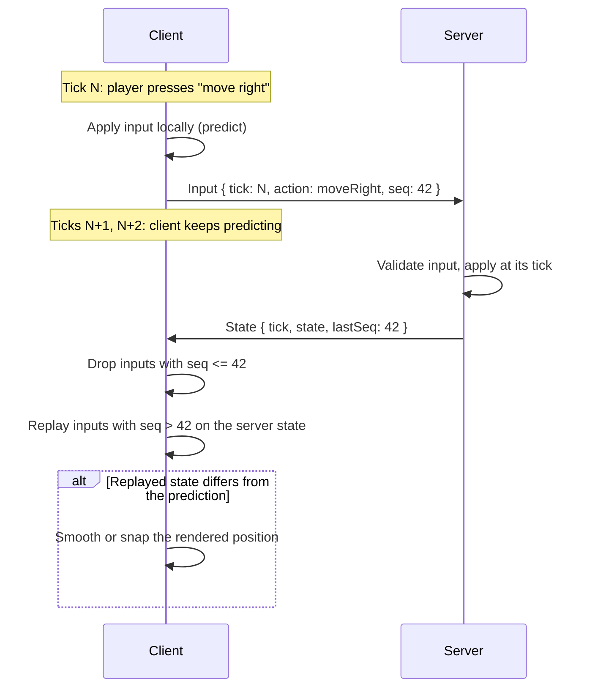

# Client architecture

The client side of server-authoritative sync: how input reaches the server, how the local player stays responsive, and how the screen stays smooth between server updates.

## Contents

- Prediction and reconciliation sequence
- Input sampling
- Client-side prediction
- Dead reckoning
- Fixed timestep with interpolated rendering
- Wiring `ClientGameLoop`

## Prediction and reconciliation sequence



## Input sampling

Collect raw input (keyboard, mouse, gamepad) every display frame. Sample it once per simulation tick and send it tagged with that tick.

```typescript
const rawInputs: RawInput[] = [];

// Render loop, display rate
function onFrame() {
  rawInputs.push(captureCurrentInput());
}

// Simulation loop, tick rate
function onTick(tick: number) {
  const sampled = mergeInputs(rawInputs); // sum mouse deltas, OR the buttons
  rawInputs.length = 0;
  sendToServer({ tick, sequence: nextSequence(), input: sampled });
}
```

Rules:

- Never drop input. When several frames fall inside one tick, merge them: sum mouse deltas, keep a button pressed if it was pressed in any frame.
- Tag every input with its tick and a sequence number. The server echoes the last sequence it processed.
- Size the client's input buffer to hold every input in flight for one round trip (round-trip time divided by tick duration), with headroom for latency spikes. `ClientGameLoop` keeps this ring buffer (`inputBufferSize`).

## Client-side prediction

Apply each input to the local state at once, then send it. When the server's state arrives, rebuild the local state from it and replay the inputs the server has not yet acknowledged (sequence diagram above).

```typescript
const input = captureTickInput(currentTick);
localState = applyInput(localState, input); // predict
sendToServer(input);
```

The client sees its own avatar in the present and every other entity in the past. Predict only what the local player controls. Hold irreversible results, such as a kill or a pickup, until the server confirms them; another player's action may still change the outcome.

## Dead reckoning

When an entity's motion is predictable (cars, ships), extrapolate from its last known velocity until the next update arrives. When speed and direction can change instantly (players in a shooter), dead reckoning guesses wrong; use entity interpolation instead.

```typescript
interface EntitySnapshot {
  position: { x: number; y: number };
  velocity: { x: number; y: number };
  lastUpdateTick: number;
}

function deadReckon(
  entity: EntitySnapshot,
  currentTick: number,
  tickDurationSeconds: number,
): { x: number; y: number } {
  const elapsed = (currentTick - entity.lastUpdateTick) * tickDurationSeconds;
  return {
    x: entity.position.x + entity.velocity.x * elapsed,
    y: entity.position.y + entity.velocity.y * elapsed,
  };
}
```

Rules:

- Cap extrapolation time. Source stops at 0.25 s of packet loss because the error grows too large after that. Past the cap, freeze the entity and show it as stale.
- When the real update arrives, blend from the extrapolated position to the corrected one over a short time instead of snapping. Source smooths its own prediction errors the same way.
- For turning vehicles, include angular velocity in the snapshot and extrapolate heading too.

`ClientGameLoop.isExtrapolating()` tells you when the server is overdue (`maxExtrapolationMs`). It does not move entities; call your own `deadReckon` when it returns true.

## Fixed timestep with interpolated rendering

Run game logic at a fixed tick and render at display rate. Carry unsimulated time in an accumulator, and use the leftover fraction to interpolate between the previous and current state.

```typescript
const tickDuration = 1000 / TICK_RATE;
let previous = performance.now();
let accumulator = 0;
let prevState = initialState;
let currState = initialState;

function loop(timestamp: number) {
  accumulator += Math.min(timestamp - previous, 250); // cap to avoid the spiral of death
  previous = timestamp;

  while (accumulator >= tickDuration) {
    prevState = currState;
    currState = simulateTick(currState);
    accumulator -= tickDuration;
  }

  render(interpolate(prevState, currState, accumulator / tickDuration));
  requestAnimationFrame(loop);
}
```

This gives:

- Logic that steps by the same `dt` whatever the frame rate.
- Smooth output at 60, 120 or 144 Hz.
- Rendered positions that always lie between two valid simulation states.

Cap the frame time added to the accumulator. If the simulation cannot keep up, each frame asks for more steps than the last and falls further behind.

## Wiring `ClientGameLoop`

`boilerplate/game-loop-client.ts` combines the pieces above: fixed timestep, input ring buffer, prediction and reconciliation.

```typescript
import { ClientGameLoop } from './game-loop-client';

const loop = new ClientGameLoop<MyGameState, MyInput>(initialState, {
  tickRate: 20,
  inputBufferSize: 128,
  interpolationDelay: 2,
  maxExtrapolationMs: 250,
});

loop.captureInput = () => readLocalInput();                // null when idle
loop.applyInput = (state, input) => applyMovement(state, input);
loop.onTick = (state, tick) => applyPhysics(state, tick);
loop.onSendInput = (buffered) => socket.send(JSON.stringify(buffered));
loop.onRender = (state, alpha) => renderer.draw(state, alpha);

socket.onmessage = (event) => {
  const msg = JSON.parse(event.data);
  if (msg.type === 'joined') {
    // Count ticks from the server's tick, then start.
    loop.syncTick(msg.tick);
    loop.start();
    return;
  }
  // Reconciles: drops acknowledged inputs, then re-runs each tick after
  // msg.tick on msg.state: that tick's unacknowledged input, then onTick
  loop.handleServerUpdate(msg.state, msg.tick, msg.lastSeq);
};
```

`syncTick` matters: reconciliation replays ticks by number, so the client must count the same ticks as the server. If an update arrives with a tick at or past the client's, or further behind than `inputBufferSize` ticks, the loop takes the server's state and tick instead of replaying.

`onServerUpdate` is a notification hook only; reconciliation happens inside `handleServerUpdate`. `onRender` receives the current state and alpha; interpolating fields is the renderer's job, or call `getInterpolationData()` for the previous and current state (it deep-clones both).

When a rendering engine owns the frame loop, skip `start()` and `onRender`. Call `loop.step(now)` from the engine's per-frame callback: it runs the same fixed ticks and returns the alpha. Then read `getRenderState()`, which returns the previous and current state by reference, and write transforms. Pass `step()` one time source (the rAF time or `performance.now()`, not both). When the tab is hidden, stop calling `step()` and call `resetClock()`; after the resync, call `resetClock()` again and resume. Engines such as Phaser resume their loop as soon as the tab shows, so gate `step()` behind a paused flag rather than relying on the engine to stop.
