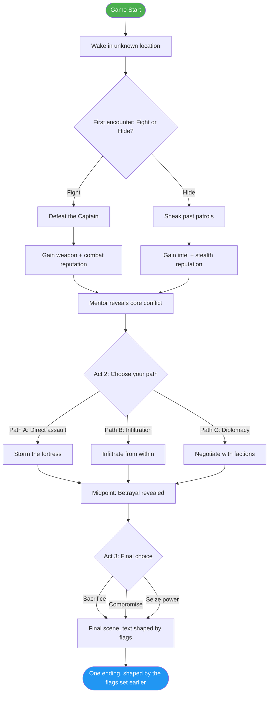

# Branching Narrative Diagram Template

Use this template to document branching story paths. Two formats are provided: Mermaid flowchart (for rendering) and indented list (for quick reference).

---

## Format 1: Mermaid Flowchart

Use this in any Markdown renderer that supports Mermaid (GitHub, GitLab, Obsidian, etc.).



### Node Types

| Shape | Meaning | Syntax |
|-------|---------|--------|
| `([text])` | Terminal (start/end) | `START([Game Start])` |
| `[text]` | Story beat (linear) | `BEAT_001[Description]` |
| `{text}` | Decision node (player choice) | `BEAT_002{Fight or Hide?}` |
| `-->` | Transition | `A --> B` |
| `-->\|label\|` | Labeled transition (choice text) | `A -->\|Fight\| B` |

---

## Format 2: Indented List

For quick documentation without rendering tools.

```
START: Game Start
├── BEAT-001: Wake in unknown location
│   └── BEAT-002: [CHOICE] First encounter — Fight or Hide?
│       ├── (Fight) BEAT-002A: Defeat the Captain
│       │   └── RESULT: Gain weapon + combat reputation
│       │       └── → MERGE → BEAT-003
│       └── (Hide) BEAT-002B: Sneak past patrols
│           └── RESULT: Gain intel + stealth reputation
│               └── → MERGE → BEAT-003
├── BEAT-003: Mentor reveals core conflict
│   └── ACT2: [CHOICE] Choose your path
│       ├── (Path A) Storm the fortress
│       ├── (Path B) Infiltrate from within
│       └── (Path C) Negotiate with factions
│           └── → ALL MERGE → MIDPOINT
├── MIDPOINT: Betrayal revealed
│   └── ACT3: [CHOICE] Final choice
│       ├── (Sacrifice) → FINALE
│       ├── (Compromise) → FINALE
│       └── (Seize power) → FINALE
│           └── ENDING: one ending, shaped by the flags set earlier
```

### Legend

- `[CHOICE]` — Player decision point
- `→ MERGE →` — Branches converge to a single node
- `RESULT:` — Consequence of a choice
- `(Label)` — Choice option text

---

## Guidelines

1. **Decision nodes**: keep the option count low. Every option needs its own written result.
2. **Merge points** cheapen earlier choices. Carry their effects past the merge in the world, dialogue and options.
3. **Track variables**: Note which flags/variables each branch sets (e.g., `combat_reputation += 1`).
4. **Test every path that remains after the cuts**: each branch combination you kept must be playable start-to-finish. The full tree is too large to test.
5. **Shape the ending with flags**: document which flags change the final scene. If you add separate endings, each must be a full, different story, and you name and document how each is reached.
6. **Avoid dead ends**: Every node must lead somewhere. If a branch fails, redirect rather than terminate.
